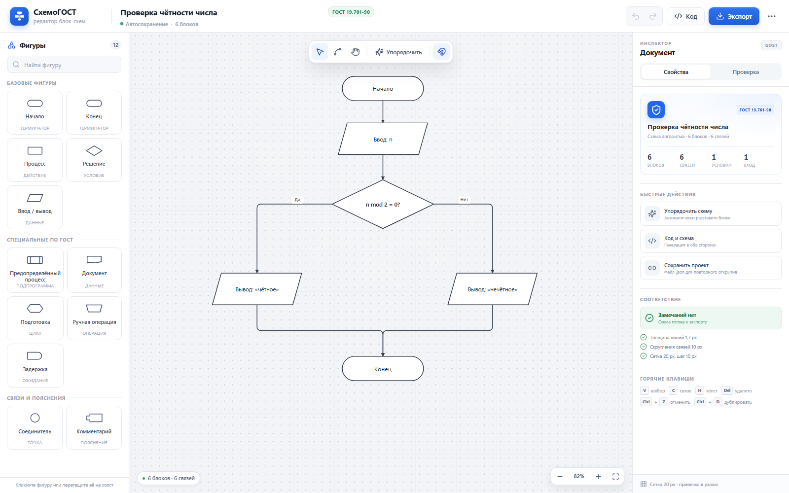
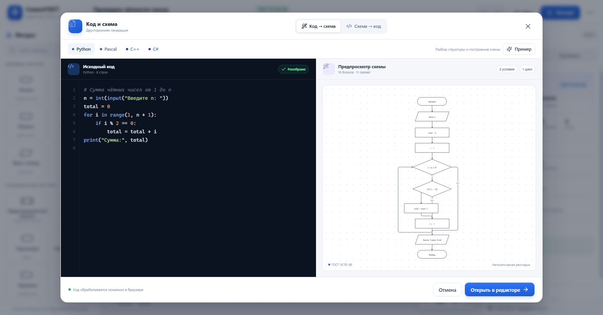

# СхемоГОСТ

Редактор блок-схем по **ГОСТ 19.701-90** с генерацией схем из кода и обратной генерацией кода. Работает полностью в браузере: без бэкенда, регистрации и отправки данных наружу.



## Возможности

### Редактор

- 12 фигур по ГОСТ: начало/конец, процесс, решение, ввод-вывод, предопределённый процесс, документ, подготовка, ручная операция, задержка, соединитель, комментарий.
- Ортогональные связи со скруглением 10 px и аккуратными стрелками.
- Сетка 20 px, привязка к шагу 10 px, resize с сохранением ровных краёв.
- Перемещение одиночных блоков и групп, выделение рамкой, Shift-выделение.
- Соединение через порты блоков или инструмент «Связь».
- Ветвления сходятся в общую линию без лишнего соединителя.
- Выравнивание по шести направлениям, распределение по горизонтали/вертикали, одинаковая ширина и высота.
- Автоматическая раскладка «Упорядочить».
- Редактор текста прямо на холсте, инспектор геометрии и типографики.
- Отмена/повтор, дублирование, удаление, проверка схемы на разрывы, наложения и незавершённые ветви.
- Автосохранение в `localStorage`, импорт и сохранение проекта в JSON.

### Код ↔ схема



Встроенная студия поддерживает **Python, Pascal, C++ и C#**:

- разбор условий, циклов, ввода-вывода, функций и `switch`;
- построение аккуратной схемы с автоматической раскладкой;
- генерация кода из схемы на выбранном языке;
- подсветка синтаксиса, примеры, обработка ошибок с номером строки;
- копирование и скачивание сгенерированного кода.

### Экспорт

- **PNG** — 1,5×/2×/3×/4×, белая или прозрачная подложка.
- **SVG** — векторный файл без потерь, подписи не обрезаются.
- **PDF** — вписывание в A4 с сохранением пропорций.
- **JSON** — проект со всеми блоками, связями и координатами.
- Экспорт всегда без интерфейса редактора, только схема.

## Запуск без npm

Приложение уже собрано в папке `dist/`. Для повседневного запуска npm не нужен:

1. Дважды кликните **`start.cmd`** в папке проекта.
2. Откроется браузер с редактором на `http://127.0.0.1:5188/`.
3. Чтобы остановить приложение, закройте окно консоли или нажмите `Ctrl+C`.

Нужен только установленный **Node.js**. Скрипт `start.cmd` запускает встроенный лёгкий сервер `serve.mjs` без зависимостей и сам открывает браузер. `npm` понадобится только для пересборки приложения после изменения исходников или если папки `dist/` нет.

## Быстрый старт для разработки

Требуется Node.js 20.19+.

```bash
# через pnpm
pnpm install
pnpm dev

# или через npm
npm install
npm run dev
```

Приложение откроется на `http://127.0.0.1:5188/`.

Сборка и предпросмотр production-версии:

```bash
pnpm build
pnpm preview
# или
npm run build
npm run preview
```

Проверка тестов:

```bash
pnpm test
# или
npm test
```

## Как пользоваться

1. Выберите фигуру в левой панели — она появится в центре холста. Фигуру можно перетащить на нужное место.
2. Соедините блоки: выберите инструмент «Связь» (или потяните за синюю точку на выделенном блоке) и протяните к другому блоку.
3. Дважды кликните по блоку, чтобы изменить текст. Точные размеры и координаты доступны в инспекторе справа.
4. Нажмите «Код», чтобы открыть студию генерации в обе стороны.
5. Нажмите «Экспорт», выберите формат и скачайте готовый файл.

## Горячие клавиши

| Клавиши | Действие |
| --- | --- |
| `V` | инструмент выбора |
| `C` | инструмент связи |
| `H` | перемещение холста |
| `Space` + drag | временное перемещение холста |
| `Del` / `Backspace` | удалить выделенное |
| `Ctrl+D` | дублировать блоки |
| `Ctrl+Z` | отменить |
| `Ctrl+Y` | вернуть |
| `Ctrl+A` | выделить все блоки |
| `Ctrl+S` | сохранить JSON |
| `Ctrl+E` | открыть экспорт |
| `Ctrl+G` | открыть «Код и схема» |
| Двойной клик | редактировать текст блока |
| `Ctrl` + колесо | масштаб холста |

## ГОСТ и оформление

Проект следует графическим обозначениям ГОСТ 19.701-90 (ИСО 5807-85):

| Фигура | Обозначение |
| --- | --- |
| Овал | пуск / останов |
| Прямоугольник | процесс |
| Ромб | решение |
| Параллелограмм | ввод / вывод |
| Прямоугольник с двойными стенками | предопределённый процесс |
| «Волнистый» прямоугольник | документ |
| Шестиугольник | подготовка |
| Трапеция | ручная операция |
| D-образная фигура | задержка |
| Круг | соединитель |
| Скобка | комментарий |

Оформление по умолчанию: белая заливка, контур `#273241` толщиной 1,7 px, скругление связей 10 px, единая сетка и типографика.

## Поддерживаемый код

| Язык | Поддержка |
| --- | --- |
| Python | `def`, `if/elif/else`, `while`, `for … in range`, `print`, `input`, `return`, `break`, `continue` |
| Pascal | `program`, `begin/end`, `if`, `while`, `for`, `repeat … until`, `case`, `readln`, `writeln` |
| C++ | функции, `if/else`, `while`, `do…while`, `for`, `switch`, `cin/cout`, `printf/scanf`, `return` |
| C# | классы и методы, `if/else`, `while`, `do`, `for`, `foreach`, `switch`, `Console.*`, `return` |

### Ограничения

- Схема строится по одной функции: `main`/`Main`, функции `main` в Python или самому крупному телу.
- `break` и `continue` отображаются как действия, а не как отдельные обрывы потока.
- `try/catch`, классы и исключения показываются упрощённо.
- Обратная генерация восстанавливает структуру `if`/`while`; `for` может быть представлен эквивалентным `while`.
- Сгенерированный код — основа для доработки: типы переменных и объявления в некоторых языках могут требовать ручной правки.

## Технологии

- React 19 + TypeScript + Vite.
- Собственный SVG-холст: геометрия фигур, ортогональная маршрутизация, порты, resize, pan/zoom.
- Dagre — автоматическая иерархическая раскладка.
- jsPDF — экспорт PDF.
- Vitest — тесты парсеров, кодогенерации и раскладки.

## Структура

```text
start.cmd           запуск без npm (двойной клик)
serve.mjs           локальный статический сервер без зависимостей
dist/               готовая production-сборка
src/
  components/       Header, Palette, Canvas, Inspector, CodeStudio, ExportDialog
  constants/        фигуры ГОСТ, размеры, цвета
  data/             демо-схема и примеры кода
  hooks/            история изменений и автосохранение
  lib/
    code/           парсеры Python/Pascal/C++/C#, AST и построение схем
    autoLayout.ts   автоматическая раскладка
    codegen.ts      генерация кода из схемы
    export.ts       PNG/SVG/PDF/JSON
    geometry.ts     фигуры, связи, границы, ортогональные маршруты
    validation.ts   проверка схемы
  styles/           дизайн-система
```

## Приватность

Весь код, схемы и экспорт обрабатываются локально в браузере. Приложение не отправляет данные на сервер.
